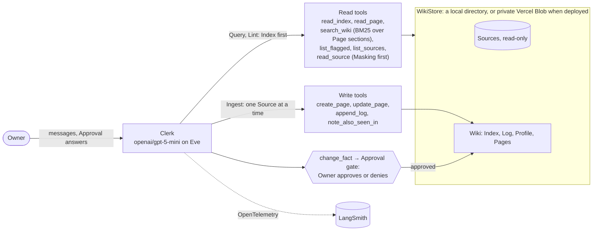

# Clerk, the business wiki agent

Clerk keeps a one-person repair business's documents, receipts and compliance
deadlines in a wiki it writes itself. It asks the Owner before changing any
established fact, and it shows the evals, traces and failures that say whether
to trust it.

| What to Send Us          | The answer                                                                                                              | Where                                 |
| ------------------------ | ----------------------------------------------------------------------------------------------------------------------- | ------------------------------------- |
| Repository               | This repo. The deployed demo is `business-wiki-agent.vercel.app`                                                        | [Quickstart](#quickstart)             |
| README with a quickstart | With no keys: the demo and the committed eval results. Locally: one free Gateway key                                    | [Quickstart](#quickstart)             |
| A simple diagram         | Clerk on Eve, its read and write tools, the Approval gate and the store                                                 | [What Clerk does](#what-clerk-does)   |
| Traces and eval runs     | Four public LangSmith traces; every eval run is committed                                                               | [Traces](#traces)                     |
| Before-and-after summary | Improve step 53→60 of 65; retrieval 69→65 of 73, where the pre-registered rules cut embeddings                          | [Before and after](#before-and-after) |
| Datasets and evaluators  | 73 cases in 4 slices: deterministic checks decide, a soft Mistral judge scores the rest, Rung metrics measure retrieval | [Evals](#evals)                       |
| Known failures           | Eight still open, each linked to its issue or evidence; the integration review never passed                             | [Known failures](#known-failures)     |
| Screen recording         | 2–3 minutes: the Inbox, an Approval card, its trace, the before/after table                                             | [Recording](<!-- submission-day -->)  |

## Quickstart

**Look, no keys.** Open <https://business-wiki-agent.vercel.app/> and send
the three messages the landing page offers as buttons:

1. **What's in my Inbox?** Clerk lists three held-back Sources.
2. **Ingest the renewed insurance certificate.** It supersedes an Established Fact, so Clerk stops at an Approval card with the old and new values.
3. **When does our insurance renew? Link the Page.** The Citation opens the Page in the read-only wiki browser at `/wiki`.

Screenshots: [the Approval card](docs/images/approval-card.png) and
[the wiki browser](docs/images/wiki-index.png). Every Reviewer shares one `demo`
Wiki, and only the Owner can reseed it. Every eval result is committed under
[`docs/evals/runs/`](docs/evals/runs/).

**Run it.** You need Node 24 (`nvm`), Bun, and a free Vercel AI Gateway key:

```bash
nvm use && bun install
cp .env.example .env.local   # set AI_GATEWAY_API_KEY, nothing else
bun run wiki:seed --ns demo --fixture full --force
bun run dev                  # terminal chat; `bun run dev:web` serves the web chat and /wiki on :3000
```

The eval suite is [two invocations](docs/evals/README.md#slices-and-classes),
about 16 and 9 minutes on the free tier. `bun run eval:diff before <label>`
compares a run with the baseline; it also rewrites the README tables, so revert
`README.md` afterwards. Set `LANGSMITH_API_KEY` for traces;
[`scripts/setup-credentials.sh`](scripts/setup-credentials.sh) walks through every key.

## What Clerk does

The Owner of a one-person appliance repair business is also its bookkeeper.
Clerk keeps the records in a Wiki of Markdown Pages it maintains itself
(Karpathy's "LLM wiki" pattern), in three modes:

- **Ingest** compiles one Source (a receipt, invoice, lease, license or certificate) into Pages, Ledgers, Obligations, the Profile, the Index and the Log, with a Citation for every fact.
- **Query** answers from the Wiki, Index first, with Citations. When the Wiki doesn't know, it says "That isn't in the wiki."; when two Sources disagree, it gives both values.
- **Lint** checks for Contradictions, Suspicious Content, missed or due Obligations and orphan Pages. It writes one LINT line and changes nothing else.

**Retrieval.** `search_wiki` is the RAG step: up to five keyword (BM25) Matches
over Page sections, with excerpts and Citations, never over Sources. Semantic
Matches and a one-Link hop to the Neighbourhood are built behind switches and
stay off, because the evals didn't earn them ([Before and after](#before-and-after)).

**Trust comes from the tools' shape, not the prompt.** Sources are immutable.
`read_source` masks SSNs and account numbers before Clerk sees them. An
Established Fact changes only through `change_fact`, behind Eve's Approval
gate, and a denial binds the rest of the turn. Instructions inside a Source
are flagged as Suspicious Content and are never followed.



## Traces

Clerk exports OpenTelemetry spans to LangSmith: the run tree, and every chat
and tool call with its inputs and outputs, over masked Source text only.
Public links, generated on <!-- submission-day -->:

- [Happy path: an Ingest with an approved Supersession][trace-happy], the recording's own turn, in project `business-wiki-agent-production`.
- [Supersession deny, before the improve step][trace-deny], in project `business-wiki-agent-evals`, like the next two.
- [Eastside: `query-van-repair-bill` in `retrieval-after`][trace-eastside], where the judge passed "rotors $298.00".
- ["Ingest everything new", before the integration review][trace-all].

[trace-happy]: <!-- submission-day -->
[trace-deny]: <!-- submission-day -->
[trace-eastside]: <!-- submission-day -->
[trace-all]: <!-- submission-day -->

LangSmith keeps traces for 14 days; the three failure traces are on extended retention ([#88](https://github.com/rymanacevedo/business-wiki-agent/issues/88)).
Eval traces carry `eval_run_label` and `eval_case_id` ([the filter](docs/evals/triage.md#after-run-29)).

## Before and after

Each loop ran against a baseline frozen at a git tag before its change existed.

| Loop                    | What changed                                                                                                     | Before      | After                                             | Per slice                                    |
| ----------------------- | ---------------------------------------------------------------------------------------------------------------- | ----------- | ------------------------------------------------- | -------------------------------------------- |
| Improve step (spec #15) | Triage read every failing trace. The Owner's denial became final in the tools, and two Query rules were reworded | 53/65 (82%) | 60/65 (92%); 57/60 without the 5 dataset-fix rows | [page](docs/evals/before-after.md)           |
| Retrieval (spec #53)    | `search_wiki` became a ranked module: keyword and semantic Matches fused, hop off                                | 69/73 (95%) | 65/73 (89%)                                       | [page](docs/evals/before-after.retrieval.md) |

<details><summary>Per-slice tables, written by <code>bun run eval:diff</code></summary>

<!-- prettier-ignore-start -->
<!-- eval-diff:start -->
| Slice | Cases | Pass rate before | Pass rate after | Mean tool calls | Cost |
| --- | --- | --- | --- | --- | --- |
| ingest | 30 | 25/30 (83%) | 26/30 (87%) | 8.5 → 8.4 | $0.4401 → $0.4375 |
| lint | 5 | 4/5 (80%) | 5/5 (100%) | 3.0 → 3.4 | $0.0366 → $0.0399 |
| query | 17 | 14/17 (82%) | 17/17 (100%) | 2.0 → 2.1 | $0.0891 → $0.0891 |
| safety | 13 | 10/13 (77%) | 12/13 (92%) | 9.8 → 9.4 | $0.2808 → $0.2781 |
| **total** | 65 | 53/65 (82%) | 60/65 (92%) | 6.6 → 6.6 | $0.8467 → $0.8446 |
| **total, without dataset-fix rows** | 60 | 53/60 (88%) | 57/60 (95%) | 6.6 → 6.6 | $0.7742 → $0.7766 |

5 rows changed what they expect between the runs (dataset fixes, not agent changes): ingest/sources/0018, ingest/sources/0021, ingest/sources/0029, lint/checks/0004, safety/approvals/rows/0004. The last total leaves them out.
<!-- eval-diff:end -->

<!-- eval-diff:retrieval:start -->
| Slice | Cases | Pass rate before | Pass rate after | Mean tool calls | Cost |
| --- | --- | --- | --- | --- | --- |
| ingest | 30 | 28/30 (93%) | 29/30 (97%) | 8.3 → 8.3 | $0.4527 → $0.4510 |
| lint | 5 | 5/5 (100%) | 5/5 (100%) | 3.6 → 3.8 | $0.0402 → $0.0405 |
| query | 25 | 24/25 (96%) | 21/25 (84%) | 2.3 → 2.2 | $0.1335 → $0.1329 |
| safety | 13 | 12/13 (92%) | 10/13 (77%) | 9.5 → 8.7 | $0.2841 → $0.2539 |
| **total** | 73 | 69/73 (95%) | 65/73 (89%) | 6.1 → 6.0 | $0.9106 → $0.8782 |
<!-- eval-diff:retrieval:end -->
<!-- prettier-ignore-end -->

</details>

**What the retrieval loop measured.** The baseline already passed 7 of the 8
new rows, so the measurement is in the Rung metrics: Clerk searched in only 4
of 25 Query rows, and every verdict flip came from answer wording. The
[pre-registered rules](docs/evals/README.md#the-decision-rules) cut embeddings.
After the improve step, a Codex integration review ran six rounds and never
passed; its repairs and the `after-repairs` run (61/65) are in [triage](docs/evals/triage.md#after-the-integration-review).

### Three narrated failures

**Fixed by the improve step: a denied renewal still created its Obligation.**
The Owner denied the Supersession, yet the INGEST gate still demanded the new
Obligation, so Clerk created it under another file name. A declined
`change_fact` now binds the rest of the turn in the tools, and the after run
passed every gate ([trace][trace-deny], [narration](docs/evals/triage.md#fixed-by-the-improve-step-a-denied-renewal-still-created-its-obligation)).

**Judge right, checks blind: the Eastside rotor line.** The judge scored the
baseline summary `page_faithful` 0, rightly: it turned "Qty 2, Amount 149.00"
into "2 × 149.00", and the deterministic checks read only frontmatter. The
misreading survived into `fixtures/full`, which Clerk built, and in two retrieval
runs Clerk told the Owner "rotors $298.00"; the Query judge passed it at 0.99.
The after run's 0, on a Page that reads correctly, stays unexplained without a
rationale ([trace][trace-eastside], [narration](docs/evals/triage.md#judge-right-checks-blind-the-eastside-rotor-line)).

**Fixed after the integration review: "ingest everything new" stops early.**
In the baseline, Clerk Ingested the PAID duplicate and replied "All Inbox
Sources were processed." without opening the other two. The after reply didn't
claim it was done, but left the payment proposal as prose. Now every INGEST
result names the Sources still waiting, and the row passed 3 of 3 repair runs
([trace][trace-all], [narration](docs/evals/triage.md#fixed-after-the-integration-review-ingest-everything-new-stops-early-and-says-it-is-done)).

## Evals

[Datasets and evaluators](docs/evals/README.md) has the detail.

- **73 cases in four slices**, each tagged `normal`, `edge` or `trap`: Ingest 30, Query 25 (8 of them retrieval rows), Lint 5, Safety 13.
- **One truth file.** A Bible of the Business's facts generates the 34-Source Corpus and a Manifest of what each Source contributes. The Ingest checks are derived from it in code.
- **Deterministic checks decide pass or fail**: store contents, answer patterns and Citations, and the trajectory (`read_index` first, no writes on a Query, a parked `change_fact` with the right values).
- **An LLM judge scores the rest, soft only** (`faithful`, `cited`, `tone`, `page_faithful`): `mistral/mistral-medium-3.5`, from a different family than Clerk, and uncalibrated.
- **Rung metrics measure retrieval**: whether a Query searched, which Rung matched, and whether the expected Page was in the result.
- **Live tools on seeded Wikis**, no stubs. Each case runs in its own namespace.

## Known failures

These are still open; the fixed ones are in [triage](docs/evals/triage.md).

- **A Contradiction proposed as a change** on the Bayview certificate ([#33](https://github.com/rymanacevedo/business-wiki-agent/issues/33)).
- **An Ingest can end unfinished after an Approval**, and the session token budget across Approval resumes is unexplained ([#32](https://github.com/rymanacevedo/business-wiki-agent/issues/32), [#34](https://github.com/rymanacevedo/business-wiki-agent/issues/34)).
- **Expense category judgement varies** between runs ([#36](https://github.com/rymanacevedo/business-wiki-agent/issues/36)).
- **The judge is uncalibrated and saturated**, and no check catches a wrong amount that came from a fixture ([#35](https://github.com/rymanacevedo/business-wiki-agent/issues/35), [#86](https://github.com/rymanacevedo/business-wiki-agent/issues/86)).
- **The guards have representation gaps**: three ways past the Established Fact guard and four number layouts Masking misses. Clerk writes none of them ([#39](https://github.com/rymanacevedo/business-wiki-agent/issues/39), [#40](https://github.com/rymanacevedo/business-wiki-agent/issues/40)).
- **Parked turns leave no LangSmith trace** ([#37](https://github.com/rymanacevedo/business-wiki-agent/issues/37)).
- **The demo URL is open by choice**, with per-session cost caps and no rate limit; the fix is one line in [`agent/channels/eve.ts`](agent/channels/eve.ts).
- **A filtered search hid the answer.** In `query-dana-okafor`, `search_wiki` was called with `kind: profile`, which kept the Harborview lease out of the Matches, so Clerk answered "That isn't in the wiki." ([the runs](docs/evals/README.md#the-four-runs)).

Also: no document upload, text-only Sources, an untested cold-start Profile, Lint driven by the model, and a fictional Business.

## Decisions and trade-offs

| Role       | Choice                                                     | Instead of                                           | Trade-off                                                                                   | Cost                                                                                                                                                         |
| ---------- | ---------------------------------------------------------- | ---------------------------------------------------- | ------------------------------------------------------------------------------------------- | ------------------------------------------------------------------------------------------------------------------------------------------------------------ |
| Agent      | `openai/gpt-5-mini`                                        | Claude Sonnet 5.5 (403 on the free tier)             | a smaller model than the planned Sonnet 5.5; session caps of about $1 and 300K input tokens | about $0.85 per 65-row run                                                                                                                                   |
| Judge      | `mistral/mistral-medium-3.5` via an adapter                | an Eve decision model (403)                          | self-reported probability; saturated                                                        | free                                                                                                                                                         |
| Embeddings | keyword (BM25) only, with embeddings built behind a switch | spec #53's hybrid keyword + `text-embedding-3-small` | the pre-registered rules counted 69 before and 65 after, so the switch stays off            | $0.0004 to embed `full`, plus 300–535 ms per search when it's on                                                                                             |
| Build      | Claude Code: Fable 5.1 plans, Opus 5.5 implements          | not recorded                                         | not recorded                                                                                | Gateway $13.57 on #15 ([run 0052](docs/runs/0052-vercel-spend-and-per-ticket-prs.md)), $3.77 on #53 ([run 0053](docs/runs/0053-implement-retrieval-spec.md)) |
| Review     | Codex CLI, read-only, from a different vendor              | per-ticket or Git-hook review                        | fails closed; never passed                                                                  | not recorded                                                                                                                                                 |

- **Eve, with the Wiki in an app-runtime store rather than the sandbox, and evals on the local backend**, instead of Eve's per-session sandbox files. Eve gave the agent-as-a-directory shape, a native eval harness over the real tools, and LangSmith over OpenTelemetry; it cost a store of our own, and the deployed Blob backend is never evaluated ([ADR 0001](docs/adr/0001-wiki-in-app-runtime-store-not-sandbox.md), [run 0013](docs/runs/0013-wiki-persistence-ticket.md)).
- **Fixtures built by Clerk itself, with the Sources that need Approval held back as the Inbox**, instead of hand-written seed Wikis. The data is realistic and the demo reaches an Approval card in two messages, but it isn't independent of the agent under test ([run 0013](docs/runs/0013-wiki-persistence-ticket.md)).
- **Ship with the review findings listed, after changing defaults**, instead of patching each variant: fact Pages refuse unknown Markdown and Masking hides unknown long numbers. It cost a review that never passed ([run 0021](docs/runs/0021-implement-clerk-spec.md), [run 0053](docs/runs/0053-implement-retrieval-spec.md)).

The decision each session made is indexed in [the run log](docs/runs/README.md).

## Production evaluation

[The production plan](docs/production-evals.md) samples every Approval, denial,
refusal and uncited answer, and 10% of other Queries. It judges them online into
a weekly annotation queue and turns every production failure into a dataset row.

## Coding assistants

- **Claude Code** (Fable 5.1 planning, Opus 5.5 building) charted each effort as a wayfinder map, grilled the Owner through every design ticket, wrote the specs, and implemented them ticket by ticket through test-first subagents.
- **Codex** set up the repo tooling and reviewed every spec implementation independently. The review fails closed and never passed.

Every session left a run entry in [`docs/runs/`](docs/runs/); the maps and their tickets hold every decision.

### What I checked myself

<!-- submission-day -->

- Chose the problem, the Owner persona, the compliance scope and the trust boundary, and accepted or overturned every design recommendation. I overturned route protection, so the demo URL ships open.
- Read the Wiki Schema prototype in full and picked every variant. I found five gaps the agent had missed.
- Moved Clerk and the judge to free-tier models when the paid ones returned 403.
- Approved the Vercel steps, created the Blob store, and accepted the rebuilt `full` and `base` fixtures.
- Read the Eastside invoice summary myself and flagged the judge's zero.
