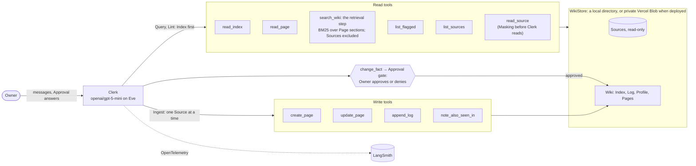

# Clerk, the business wiki agent

> **[proto]** PROTOTYPE for [Prototype: the README skeleton at 200 lines](https://github.com/rymanacevedo/business-wiki-agent/issues/79). Throwaway: it never merges.
> Lines starting `> **[proto]**` are notes for the Owner and are not counted. Everything else is the draft README at
> roughly its real length, so the count is honest. The prose is rough, so react to the shape, the order and the budgets.
> Choices for the Owner are marked **CHOICE**. The disposition of every current section is at the bottom.

Clerk keeps a one-person repair business's documents, receipts and compliance
deadlines in a wiki it writes itself. It asks the Owner before changing any
established fact, and it shows the evals, traces and failures that say whether
to trust it.

> **[proto]** Budget 4 + table 11. The table replaces the "Start here, 30 minutes" box. Each row is one line and one link.

| What to Send Us          | The answer                                                                                                             | Where                                 |
| ------------------------ | ---------------------------------------------------------------------------------------------------------------------- | ------------------------------------- |
| Repository               | This repo. The deployed demo is `business-wiki-agent.vercel.app`                                                       | [Quickstart](#quickstart)             |
| README with a quickstart | With no keys: the demo and the committed eval results. Locally: one free Gateway key                                   | [Quickstart](#quickstart)             |
| A simple diagram         | Clerk on Eve, its read and write tools, the Approval gate and the store                                                | [What Clerk does](#what-clerk-does)   |
| Traces and eval runs     | Four public LangSmith traces; every eval run is committed                                                              | [Traces](#traces)                     |
| Before-and-after summary | Improve step 53→60 of 65; retrieval 69→65 of 73, where the pre-registered rules cut embeddings                         | [Before and after](#before-and-after) |
| Datasets and evaluators  | 73 cases in 4 slices: deterministic gates decide, a soft Mistral judge scores the rest, Rung metrics measure retrieval | [Evals](#evals)                       |
| Known failures           | Seven still open, each with its issue; the integration review never passed                                             | [Known failures](#known-failures)     |
| Screen recording         | 2–3 minutes: the Inbox, an Approval card, one trace, the before/after table                                            | `<unlisted link>`                     |

## Quickstart

> **[proto]** Budget 30 (now 50). Keeps Tier 1, "Try this first" folded in, and Tier 2. Cuts "Talking to the deployed agent" (the curl
> example), the `--fixture full` seed explanation, the single-case example and "no Makefile, no Docker".

**Look, no keys.** Open <https://business-wiki-agent.vercel.app/> and send
the three messages the landing page offers as buttons:

1. **What's in my Inbox?** Clerk lists three held-back Sources.
2. **Ingest the renewed insurance certificate.** It supersedes an Established
   Fact, so Clerk stops at an Approval card with the old and new values.
3. **When does our insurance renew? Link the Page.** The Citation opens the
   Page in the read-only wiki browser at `/wiki`.

Every Reviewer shares one `demo` Wiki, and only the Owner can reseed it. Every
eval result is committed under [`docs/evals/runs/`](docs/evals/runs/).

**Run it.** You need Node 24 (`nvm`), Bun, and a free Vercel AI Gateway key:

```bash
nvm use && bun install
cp .env.example .env.local   # set AI_GATEWAY_API_KEY, nothing else
bun run wiki:seed --ns demo --fixture full --force
bun run dev                  # terminal chat; `bun run dev:web` serves the web chat and /wiki on :3000
```

The suite is two invocations, one per seed (about 16 and 9 minutes on the free tier):

```bash
EVAL_RUN_LABEL=mine WIKI_SEED=base bun run eval ingest safety/at-ingest --max-concurrency 2 --timeout 240000
EVAL_RUN_LABEL=mine WIKI_SEED=full bun run eval query lint safety/approvals safety/runtime --max-concurrency 2 --timeout 240000
```

Results land in `docs/evals/runs/mine/`, and `bun run eval:diff before mine`
compares them with the baseline. It also rewrites the README tables, so revert
`README.md` afterwards. `bun run eval --list` shows every case id. Set
`LANGSMITH_API_KEY` for traces; [`scripts/setup-credentials.sh`](scripts/setup-credentials.sh)
walks through the full credential set.

## What Clerk does

> **[proto]** Budget 40 (now 93). The Ingest, Query and Lint bullets go to one line each, and the Retrieval and trust paragraphs to 3–4
> lines each. "Why Eve" moves to Decisions. The `note_also_seen_in` paragraph is deleted (the diagram shows the tool; the ADR link
> moves to Decisions). The diagram is trimmed from 45 to 30 lines: a shorter `search_wiki` label and one `Write --> Wiki` edge
> instead of five per-tool edges.

The Owner of a one-person appliance repair business is also its bookkeeper.
Clerk keeps the Business's records in a Wiki of Markdown Pages that it
maintains itself (Karpathy's "LLM wiki" pattern). It works in three modes:

- **Ingest** compiles one Source (a receipt, invoice, lease, licence or certificate) into Pages, Ledgers, Obligations, the Profile, the Index and the Log, with a Citation for every fact.
- **Query** answers from the Wiki, Index first, with Citations. When the Wiki doesn't know, it says "That isn't in the wiki."; when two Sources disagree, it gives both values.
- **Lint** checks for Contradictions, Suspicious Content, missed or due Obligations and orphan Pages. It writes one LINT line and changes nothing else.

**Retrieval.** `search_wiki` is the RAG step: up to five keyword (BM25) Matches
over Page sections, each with excerpts and Citations. Semantic Matches and a
one-Link hop are built behind switches and stay off, because the evals didn't
earn them ([Before and after](#before-and-after)).

**Trust comes from the tools' shape, not the prompt.** Sources are immutable.
`read_source` masks SSNs and account numbers before Clerk sees them. An
Established Fact changes only through `change_fact`, behind Eve's Approval
gate. Instructions inside a Source are flagged as Suspicious Content and are
never followed.



## Traces

> **[proto]** Budget 12 (now 25). Holds at most four links (the map's decision): one happy path plus one per narrated failure. The six
> workspace link definitions at the bottom of the README are deleted; triage keeps them. The LangSmith filter syntax is deleted; it is
> in triage "After run (#29)".

Clerk exports OpenTelemetry spans to LangSmith: the run tree, every chat call
with its messages and tokens, and every tool call with its arguments and
results. Traces hold masked Source text only. Public links, generated on
`<date>` (LangSmith keeps traces for 14 days):

- Happy path, an Ingest with an approved Supersession: `<share link>`
- `<narrated failure 1>`: `<share link>`
- `<narrated failure 2>`: `<share link>`
- `<narrated failure 3>`: `<share link>`

Eval traces are in project `business-wiki-agent-evals`, tagged with `eval_run_label` and
`eval_case_id` ([the filter](docs/evals/triage.md#after-run-29)). The demo traces to
`business-wiki-agent-production`. A workspace invite is available on request.

## Before and after

> **[proto]** Budget 35 (now about 200: both generated tables, the 8-row table, the variant runs, the rules outcome, "After the integration
> review" and three narrations quoted in full). One hand-written table covers both loops, as decided.
> The 8-row table, its three "Read it as" bullets and the variant runs **move** to `docs/evals/README.md` "The four runs"; the rules and
> their outcome are already in `docs/evals/README.md` "The decision rules". "After the integration review" (after-repairs and rounds 2–6)
> **moves** to a new "After the integration review" section in `docs/evals/triage.md`, since it exists nowhere else. The narrations
> are **deleted** as quotes (triage holds them in full) and come back as one paragraph each.

The two loops ran one after the other. Each ran against a baseline frozen at a
git tag before its change existed.

| Loop                    | What changed                                                                                                     | Before      | After                                             | Per slice                                    |
| ----------------------- | ---------------------------------------------------------------------------------------------------------------- | ----------- | ------------------------------------------------- | -------------------------------------------- |
| Improve step (spec #15) | Triage read every failing trace. The Owner's denial became final in the tools, and two Query rules were reworded | 53/65 (82%) | 60/65 (92%); 57/60 without the 5 dataset-fix rows | [page](docs/evals/before-after.md)           |
| Retrieval (spec #53)    | `search_wiki` became a ranked module: keyword and semantic Matches fused, hop off                                | 69/73 (95%) | 65/73 (89%)                                       | [page](docs/evals/before-after.retrieval.md) |

> **[proto]** **CHOICE A: the generated tables.** `eval:diff` rewrites two marker blocks in the README and exits 1 if they're missing
> (it writes the docs page first). Option **A1**, recommended: keep both blocks, folded inside one `<details>` below. That needs no code
> change, adds about 24 source lines and nothing rendered, and the hand table sits beside the numbers it summarises. Option **A2**:
> drop the markers and make `eval:diff` skip a README without them (a few lines in `scripts/eval-diff.ts`, plus one test).

<details><summary>Per-slice tables, written by <code>bun run eval:diff</code></summary>

<!-- eval-diff:start -->
<!-- (the generated before → after block, 9 lines, unchanged) -->
<!-- eval-diff:end -->

<!-- eval-diff:retrieval:start -->
<!-- (the generated retrieval-before → retrieval-after block, 8 lines, unchanged) -->
<!-- eval-diff:retrieval:end -->

</details>

**What the retrieval loop measured.** The baseline already passed 7 of the 8
new rows, so the measurement is in the Rung metrics. Clerk searched in only 4
of 25 Query rows, and every verdict flip on the eight rows came from answer
wording, not retrieval. The pre-registered rules cut embeddings (a row passed
keyword-only and failed hybrid in 2 of 3 runs) and kept the hop off. The rows
and the rules are on [the evals page](docs/evals/README.md#retrieval).

After the improve step, a Codex integration review ran six rounds. It never
passed. The repairs and the `after-repairs` run (61/65) are in
[triage](docs/evals/triage.md#after-the-integration-review).

### Three narrated failures

> **[proto]** One paragraph each, about 5 lines, ending in the share link and the full narration. They wait on [Task: confirm the
> narrated failures against their traces](https://github.com/rymanacevedo/business-wiki-agent/issues/78); the second may be replaced.

**Fixed by the improve step: a denied renewal still created its Obligation.**
The Owner denied the Supersession, yet the INGEST gate still demanded the new
Obligation, so Clerk created it under another file name. A declined
`change_fact` now binds the rest of the turn in the tools, and the after run
passed every gate. ([trace](<share link>), [narration](docs/evals/triage.md#fixed-by-the-improve-step-a-denied-renewal-still-created-its-obligation))

**Judge disagreement: the Eastside invoice summary.** `<one paragraph, or its
replacement from the calibration labels>`

**Fixed after the integration review: "ingest everything new" stops early.**
`<one paragraph>`

## Evals

> **[proto]** Budget 12 (now 27). Kept almost as is. The bullets get shorter, and one bullet is added for the Rung metrics, so the row's
> three named things (deterministic checks, judge, retrieval metrics) each have a line.

[Datasets and evaluators](docs/evals/README.md) has the detail.

- **73 cases in four slices**, each tagged `normal`, `edge` or `trap`: Ingest 30, Query 25 (8 of them retrieval rows), Lint 5, Safety 13.
- **One truth file.** A Bible of the Business's facts generates the 34-Source Corpus and a Manifest of what each Source contributes. The Ingest checks are derived from it in code.
- **Deterministic checks decide pass or fail**: store contents, answer patterns and Citations, and the trajectory (`read_index` first, no writes on a Query, a parked `change_fact` with the right values).
- **An LLM judge scores the rest, soft only** (`faithful`, `cited`, `tone`, `page_faithful`): `mistral/mistral-medium-3.5`, from a different family than Clerk, and uncalibrated.
- **Rung metrics measure retrieval**: whether a Query searched, which Rung matched, and whether the expected Page was in the result.
- **Live tools on seeded Wikis**, no stubs. Each case runs in its own namespace.

## Known failures

> **[proto]** Budget 12 (now 130). Has seven bullets, each linking its issue. The "Failures we saw" entries that are fixed are **deleted**
> (triage holds them, cluster by cluster). The "Limitations we chose" entries about the evals **move** to a new "Limits of these evals"
> section at the end of `docs/evals/README.md`: single runs, the self-reported judge probability, bare Source-id Citations, the
> Links that duplicate text, the small Index, and evals on the local store only. The open demo URL becomes bullet 7 (it has no issue, so
> it links the code). The rest collapses into the last line.
> **CHOICE B:** the last line keeps the small product limits in the README, or deletes them. Recommended: keep them, since they live nowhere else.

These are still open; the fixed ones are in [triage](docs/evals/triage.md).

- **A Contradiction proposed as a change** on the Bayview certificate ([#33](https://github.com/rymanacevedo/business-wiki-agent/issues/33)).
- **An Ingest can end unfinished after an Approval**, and the session token budget across Approval resumes is unexplained ([#32](https://github.com/rymanacevedo/business-wiki-agent/issues/32), [#34](https://github.com/rymanacevedo/business-wiki-agent/issues/34)).
- **Expense category judgement varies** between runs ([#36](https://github.com/rymanacevedo/business-wiki-agent/issues/36)).
- **The judge is uncalibrated and saturated**, with two known disagreements ([#35](https://github.com/rymanacevedo/business-wiki-agent/issues/35)).
- **The guards have representation gaps**: three ways past the Established Fact guard and four number layouts Masking misses. Clerk writes none of them ([#39](https://github.com/rymanacevedo/business-wiki-agent/issues/39), [#40](https://github.com/rymanacevedo/business-wiki-agent/issues/40)).
- **Parked turns leave no LangSmith trace** ([#37](https://github.com/rymanacevedo/business-wiki-agent/issues/37)).
- **The demo URL is open by choice**, with per-session cost caps and no rate limit; the fix is one line in [`agent/channels/eve.ts`](agent/channels/eve.ts).

Also: no document upload, text-only Sources, an untested cold-start Profile, Lint driven by the model, and a fictional Business.

## Decisions and trade-offs

> **[proto]** Budget 14 (new). The model table comes from [Research: the decision and trade-off each run records](https://github.com/rymanacevedo/business-wiki-agent/issues/77). The three
> headline bullets wait on [Which decisions headline the README](https://github.com/rymanacevedo/business-wiki-agent/issues/80). "Why Eve" and the ADR 0001 link land here, from What Clerk does.

| Role       | Choice                                            | Instead of                               | Trade-off                            | Cost                              |
| ---------- | ------------------------------------------------- | ---------------------------------------- | ------------------------------------ | --------------------------------- |
| Agent      | `openai/gpt-5-mini`                               | Claude Sonnet 5.5 (403 on the free tier) | `<trade-off>`                        | about $0.85 per 65-row run        |
| Judge      | `mistral/mistral-medium-3.5` via an adapter       | an Eve decision model (403)              | self-reported probability; saturated | free                              |
| Embeddings | `text-embedding-3-small`, off                     | keyword-only                             | cut by the pre-registered rules      | $0.0004 to embed `full`           |
| Build      | Claude Code: Fable 5.1 plans, Opus 5.5 implements | `<none recorded>`                        | `<trade-off>`                        | Gateway $13.57 (#15), $3.77 (#53) |
| Review     | Codex CLI, read-only, from a different vendor     | per-ticket or Git-hook review            | fails closed; never passed           | `<not recorded>`                  |

- `<headline decision 1>`
- `<headline decision 2>`
- `<headline decision 3>`

The decision each session made is indexed in [the run log](docs/runs/README.md).

## Production evaluation

> **[proto]** Budget 6 (now 18). Five bullets become one paragraph; `docs/production-evals.md` already holds the detail.

[The production plan](docs/production-evals.md) samples every Approval and
denial, every refusal or uncited answer, and 10% of other Queries. It runs
`faithful` and `cited` online into a weekly annotation queue and relabels twenty
a week to watch for judge drift. It monitors traces deterministically (a write
before `read_index`, a `change_fact` without an Approval, a PII hit, cost). Every
production failure becomes a dataset row.

## Coding assistants

> **[proto]** Budget 18 (now 47). Has 10 lines plus "What I checked myself". The "Planned for this list, but not done" block is
> **deleted**: it was scaffolding, and its live items are on `docs/submission-checklist.md`. The Repo map after this section is **cut** (decided).

- **Claude Code** (Fable 5.1 planning, Opus 5.5 building) charted each effort as a wayfinder map, grilled the Owner through every design ticket, wrote the specs, and implemented them ticket by ticket through test-first subagents.
- **Codex** set up the repo tooling and reviewed every spec independently. The review fails closed and never passed.

Every session left a run entry in [`docs/runs/`](docs/runs/), and the map and
its tickets hold every decision.

### What I checked myself

`<Owner: 4–6 bullets, about 8 lines, in your own words.>`

<!-- ================= PROTOTYPE NOTES BELOW: not part of the README ================= -->

---

## [proto] Disposition of the current README (788 lines on `main`)

| Current section                                              | Lines | Fate                                                           | Where its content goes                                                                        |
| ------------------------------------------------------------ | ----- | -------------------------------------------------------------- | --------------------------------------------------------------------------------------------- |
| Title + pitch                                                | 5     | Kept, reworded                                                 | the README                                                                                    |
| "Start here, 30 minutes" box                                 | 15    | Deleted                                                        | replaced by the What to Send Us table                                                         |
| Quickstart, Tier 1                                           | 14    | Kept, merged with Try this first                               | the README                                                                                    |
| Quickstart, Tier 2                                           | 34    | Condensed                                                      | the README; the single-case example and "no Makefile" are deleted                             |
| What Clerk does (modes, retrieval, trust)                    | 50    | Condensed                                                      | the README; Glossary terms already define the vocabulary                                      |
| Why Eve                                                      | 5     | Moved                                                          | the README, Decisions and trade-offs                                                          |
| Mermaid diagram                                              | 45    | Trimmed to about 30                                            | the README                                                                                    |
| `note_also_seen_in` / Lint skill / ADR                       | 5     | Deleted; the ADR link moves                                    | the diagram shows the tool; ADR 0001 is linked from Decisions                                 |
| Try this first                                               | 26    | Condensed into Quickstart                                      | the README; the screenshot line stays only if the checklist step happens                      |
| Talking to the deployed agent (curl)                         | 14    | Cut (decided)                                                  | nowhere                                                                                       |
| Evals                                                        | 27    | Condensed, plus the Rung metrics bullet                        | the README; the detail is already in `docs/evals/README.md`                                   |
| Retrieval, measured: intro + rules outcome                   | 40    | Deleted                                                        | already in `docs/evals/README.md` "Retrieval" and "The decision rules"                        |
| Retrieval, measured: generated block                         | 11    | Kept in `<details>` (CHOICE A)                                 | the README                                                                                    |
| Retrieval, measured: 8-row table, "Read it as", variant runs | 40    | **Moved**                                                      | `docs/evals/README.md` "The four runs" (its pointer back to the README is dropped)            |
| What broke and what changed: intro                           | 10    | Condensed into the one table                                   | the README                                                                                    |
| What broke and what changed: generated block                 | 13    | Kept in `<details>` (CHOICE A)                                 | the README                                                                                    |
| After the integration review (after-repairs, rounds 2–6)     | 37    | **Moved**; 2 lines stay                                        | a new `docs/evals/triage.md` section, "After the integration review" (it exists nowhere else) |
| Three narrated failures (quoted in full)                     | 135   | Deleted as quotes; one paragraph each                          | already in full in `docs/evals/triage.md` "Three narrated failures"                           |
| Traces                                                       | 25    | Condensed; the filter syntax is deleted                        | the filter is already in triage "After run (#29)"                                             |
| Production evaluation                                        | 18    | Condensed to one paragraph                                     | already in `docs/production-evals.md`                                                         |
| Known failures: Failures we saw                              | 75    | The fixed ones are deleted; the open ones become six bullets   | triage clusters and issues #32–#37, #39, #40 already hold the detail                          |
| Known failures: Limitations we chose, eval ones              | 25    | **Moved**                                                      | a new `docs/evals/README.md` section, "Limits of these evals"                                 |
| Known failures: Limitations we chose, the rest               | 25    | The open URL becomes a bullet; the rest is one line (CHOICE B) | the README; the `httpBasic` code snippet is deleted (the bullet links the file)               |
| Coding assistants                                            | 17    | Condensed                                                      | the README                                                                                    |
| What I checked myself (draft)                                | 12    | Rewritten by the Owner                                         | the README                                                                                    |
| "Planned for this list, but not done"                        | 12    | Deleted                                                        | the live items are already on `docs/submission-checklist.md`                                  |
| Repo map                                                     | 16    | Cut (decided)                                                  | nowhere                                                                                       |
| Workspace trace link definitions                             | 8     | Deleted                                                        | already in `docs/evals/triage.md`                                                             |

**Knock-on edits outside the README** (all of them receive moved content or fix a pointer):
`docs/evals/README.md` (two sections receive content; one pointer to "Retrieval, measured" is retargeted),
`docs/evals/triage.md` (one section receives content), `docs/submission-checklist.md` (its "README quotes" and
"Traces section" wording). Under A2, the Quickstart's "revert `README.md` afterwards" clause goes too.

**CHOICE C: the draft is over budget.** Measured with notes excluded, it is 243 lines, about 258 with the real generated blocks
(about 26 of them folded in `<details>`), and the two placeholder narrations add about 8 more. That is about 225 rendered against a
target of about 200. Ranked cut candidates: (a) the diagram, from 30 to about 18 lines, by listing the tools inside one node per
subgraph instead of one node per tool, saving 12; (b) the Quickstart's eval-invocation block, pointing to `docs/evals/README.md`
instead (where the commands already are), saving 8; (c) the decision table's "Instead of" column, which is thin for the build rows,
saving 0 lines but making the table narrower; (d) Traces, folding the project-name paragraph into the link list, saving 4; (e)
Production evaluation, from 6 to 3 lines, saving 3. With (a), (b), (d) and (e), it is about 200 rendered.

**Other open questions for the Owner.** (1) The Quickstart sits before the diagram, in the table's order, as decided. Is the 4-line
pitch enough for a reviewer who meets the commands before the picture? (2) Should the before/after table get a third row for
`after-repairs` (61/65), or stay at two rows with a pointer, as drafted?
